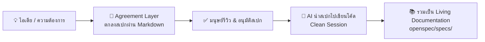

# 📘 OpenSpec Manual (คู่มือการใช้งาน OpenSpec ภาษาไทย)

<div align="center">

[](https://chanchai9666.github.io/openspec-manual/)
[-818cf8?style=for-the-badge)](https://chanchai9666.github.io/openspec-manual/)
[](https://nodejs.org/)
[](https://openspec.dev)
[](LICENSE)

<br/>

**คู่มือภาษาไทยฉบับสมบูรณ์ (Unofficial v1.x) สำหรับการพัฒนาซอฟต์แวร์ด้วยแนวคิด Spec-Driven Development (SDD)**  
*เปลี่ยนการสั่งงาน AI จากการเดาสุ่ม (Vibe Coding) ให้กลายเป็นกระบวนการทางวิศวกรรมที่แม่นยำด้วย Agreement Layer รองรับ AI Coding Agents กว่า 30+ ตัว*

[🌐 เปิดอ่านคู่มือออนไลน์ (Live Web Manual)](https://chanchai9666.github.io/openspec-manual/) • [✨ จุดเด่น](#-จุดเด่นของเว็บคู่มือ-features) • [🚀 เริ่มต้นใช้งาน](#-วิธีเปิดอ่านคู่มือ-getting-started) • [📋 สารบัญเนื้อหา](#-สารบัญเนื้อหาภายในคู่มือ) • [🤖 AI ที่รองรับ](#-ai-coding-assistants-ที่รองรับ-30-agents)

---

</div>

## 📌 ข้อมูลสำหรับการตั้งค่า GitHub Repo (About Metadata)

หากต้องการนำไปตั้งค่าที่กล่อง **About** (มุมขวาบนของหน้าคลัง GitHub):

| รายการ | ค่าที่แนะนำ |
| :--- | :--- |
| **Description** | `คู่มือการใช้งาน OpenSpec ภาษาไทยฉบับสมบูรณ์ (Unofficial v1.x) — Spec-Driven Development (SDD) & Agreement Layer สำหรับ AI Coding Agents กว่า 30+ ตัว (Antigravity, Cursor, Claude Code, Copilot ฯลฯ)` |
| **Website** | `https://chanchai9666.github.io/openspec-manual/` |
| **Topics / Tags** | `openspec`, `spec-driven-development`, `sdd`, `ai-coding`, `thai-documentation`, `antigravity`, `claude-code`, `cursor`, `ai-agents`, `prompt-engineering`, `developer-tools`, `specification` |

---

## 💡 OpenSpec คืออะไร? และทำไมต้อง Spec-Driven Development (SDD)?

ในการเขียนโค้ดร่วมกับ AI Assistant ยุคปัจจุบัน หลายคนประสบปัญหา:
- ❌ **Context Drift & Hallucination:** สั่งงานไปเรื่อย ๆ จน AI เริ่มลืมบริบทเก่า มั่วคำตอบ หรือเผลอลบโค้ดเดิม
- ❌ **Scope Creep:** AI เขียนฟังก์ชันส่วนเกินหรือแก้นอกขอบเขตที่ต้องการ
- ❌ **Lack of Verification:** ไม่รู้ว่า AI ทำงานตรงตามความต้องการครบถ้วนหรือไม่

**OpenSpec** เข้ามาแก้ปัญหานี้ด้วยแนวคิด **Spec-Driven Development (SDD)**:



1. **🎯 Agreement Layer:** ตกลงขอบเขต พฤติกรรม และเงื่อนไขที่ยอมรับได้ (Acceptance Criteria) กับ AI ในไฟล์ Markdown ก่อนแตะต้องโค้ดจริง
2. **🛡️ ป้องกัน Scope Drift:** AI จะปฏิบัติตามพิมพ์เขียวที่ระบุไว้ ไม่แอบแก้โค้ดส่วนอื่น
3. **🧹 จัดการ Context Window:** แยกขั้นตอนคิด (Explore/Propose) ออกจากขั้นตอนลงมือทำ (Apply) ทำให้เปิด Clean Session สำหรับเขียนโค้ดได้เสมอ
4. **📖 Living Documentation:** เอกสารสเปกในโฟลเดอร์ `openspec/specs/` จะเติบโตไปพร้อมกับโค้ดจริง ไม่มีวันล้าสมัย

---

## ✨ จุดเด่นของเว็บคู่มือ (Features)

เว็บคู่มือ [index.html](file:///Users/chanchai/workshop/openspec-manual/index.html) ได้รับการออกแบบเป็น Single-Page Web Application ที่สมบูรณ์แบบและใช้งานได้จริงทันที:

- 🌗 **Dark / Light Theme:** รองรับธีมมืดและธีมสว่าง พร้อมบันทึกสถานะลง `localStorage`
- 🔍 **Live Search & Quick Filter:** ค้นหาหัวข้อ คำสั่ง หรือคีย์เวิร์ดได้ทันทีแบบเรียลไทม์ พร้อม Highlight คำค้นหา
- 📋 **One-Click Code Copy:** ปุ่มคัดลอกโค้ดและคำสั่ง CLI พร้อม Interactive Toast Feedback
- 📱 **Fully Responsive:** ใช้งานได้ไหลลื่นทั้งบน Desktop, Tablet และ Smart Phone
- 🧭 **Sidebar Active Navigation & Reading Progress:** แถบสารบัญด้านข้างแสดงตำแหน่งการอ่านปัจจุบันพร้อมตัววัดความคืบหน้า
- ⌨️ **Keyboard Shortcut:** กด `Ctrl + K` หรือ `Cmd + K` เพื่อโฟกัสช่องค้นหาได้ทันที

---

## 🚀 วิธีเปิดอ่านคู่มือ (Getting Started)

### ทางเลือกที่ 1: อ่านผ่านออนไลน์ (GitHub Pages)
เข้าชมคู่มือเวอร์ชันล่าสุดได้ทันทีที่:  
👉 **[https://chanchai9666.github.io/openspec-manual/](https://chanchai9666.github.io/openspec-manual/)**

*(วิธีเปิดใช้งานบน GitHub: ไปที่ Settings > Pages > Source เลือก Deploy from a branch `main` / `root`)*

---

### ทางเลือกที่ 2: เปิดอ่านบนเครื่องของคุณเอง (Local)
เนื่องจากโปรเจกต์ถูกสร้างขึ้นเป็น Pure HTML5 + CSS3 + Vanilla JavaScript โดยไม่มี Dependencies ภายนอกที่ต้องติดตั้ง คุณสามารถเปิดอ่านได้ทันที:

```bash
# โคลนคลังเก็บโค้ด
git clone https://github.com/chanchai9666/openspec-manual.git
cd openspec-manual

# เปิดไฟล์ด้วยเบราว์เซอร์เริ่มต้น
# สำหรับ macOS:
open index.html

# สำหรับ Linux:
xdg-open index.html

# สำหรับ Windows (PowerShell):
start index.html
```

หรือหากต้องการรันผ่าน Local HTTP Server:
```bash
# ตัวเลือกที่ 1: ใช้ npx serve
npx serve .

# ตัวเลือกที่ 2: ใช้ Python
python3 -m http.server 8000
```

---

## 📋 สารบัญเนื้อหาภายในคู่มือ

คู่มือแบ่งออกเป็น 14 หัวข้อหลัก ครอบคลุมตั้งแต่ระดับเริ่มต้นจนถึงใช้งานระดับสูงในโปรดักชัน:

| บทที่ | หัวข้อ | รายละเอียด |
| :---: | :--- | :--- |
| **1** | [สรุปภาพรวม & แนวคิด SDD](https://chanchai9666.github.io/openspec-manual/#intro) | เข้าใจบทบาทของ Agreement Layer และการยกระดับจากการเดาสุ่มสู่มาตรฐานวิศวกรรม |
| **2** | [ข้อกำหนดของระบบ & การติดตั้ง CLI](https://chanchai9666.github.io/openspec-manual/#prereq-install) | ความต้องการระบบ (Node.js >= 20.19.0) วิธีติดตั้งผ่าน npm, brew, bun, deno, nix |
| **3** | [คำสั่ง 2 ประเภท (CLI vs AI Agent)](https://chanchai9666.github.io/openspec-manual/#commands-types) | แยกความแตกต่างระหว่างคำสั่งใน Terminal กับคำสั่ง Prompt ในแชทของ AI |
| **4** | [เริ่มต้นโปรเจกต์ใหม่ (Quickstart)](https://chanchai9666.github.io/openspec-manual/#quickstart) | คำสั่ง `openspec init` และการตั้งค่า AI Skills / Rules ลงในโปรเจกต์ |
| **5** | [วงจรการทำงานหลัก (Workflow Lifecycle)](https://chanchai9666.github.io/openspec-manual/#workflow) | ขั้นตอน 4 ลำดับ: **Explore ➔ Propose ➔ Apply ➔ Archive** |
| **6** | [การเรียกใช้งานผ่าน AI Agents แต่ละค่าย](https://chanchai9666.github.io/openspec-manual/#agents-cmds) | วิธีสั่งงานบน Google Antigravity, Claude Code, Cursor, Copilot, Cline, ฯลฯ |
| **7** | [เทคนิคขั้นสูง (Tips & Tricks)](https://chanchai9666.github.io/openspec-manual/#tricks) | Context resetting, การใช้ Test-Driven ควบคู่, การปรับแต่ง System Prompt |
| **8** | [แนวทางปฏิบัติที่ดี (Best Practices)](https://chanchai9666.github.io/openspec-manual/#best-practices) | ขนาดของ Change, การตั้งชื่อไฟล์, และการเขียน Acceptance Criteria ที่ดี |
| **9** | [โปรเจกต์ใหม่ (Greenfield Projects)](https://chanchai9666.github.io/openspec-manual/#greenfield) | แนวทางเริ่มต้นวางโครงสร้างโปรเจกต์ใหม่ตั้งแต่บรรทัดแรก |
| **10** | [โปรเจกต์เดิมที่มีอยู่แล้ว (Brownfield Projects)](https://chanchai9666.github.io/openspec-manual/#brownfield) | เทคนิคการทำ Reverse-Spec และนำ OpenSpec มาประยุกต์ใช้กับ Legacy Code |
| **11** | [การดูแลและอัปเดตสเปก (Spec Maintenance)](https://chanchai9666.github.io/openspec-manual/#spec-maintenance) | การผสานสเปกเข้าคลังหลัก และการจัดการสเปกที่หมดอายุ |
| **12** | [ตัวอย่างไฟล์สเปกจริง (Real-World Examples)](https://chanchai9666.github.io/openspec-manual/#examples) | โครงสร้างไฟล์สเปก `proposal.md`, `specs/`, `tasks.md` ตัวอย่างระบบ Authentication |
| **13** | [สรุปคำสั่ง CLI ทั้งหมด (CLI Reference)](https://chanchai9666.github.io/openspec-manual/#cli-cmds) | ตารางคำสั่ง Flag และ Parameter อย่างละเอียด |
| **14** | [Cheatsheet สรุปย่อคำสั่งพร้อมใช้](https://chanchai9666.github.io/openspec-manual/#cheatsheet) | แผ่นสรุปคำสั่งย่อที่พบบ่อย พร้อมคัดลอกไปใช้งานได้ทันที |

---

## 🤖 AI Coding Assistants ที่รองรับ (30+ Agents)

OpenSpec รองรับการทำงานร่วมกับ AI Coding Assistant ชั้นนำเกือบทุกตัวในท้องตลาด:

| ประเภท | เครื่องมือ / เอเจนต์ |
| :--- | :--- |
| **IDE & Editors** | Google Antigravity IDE, Cursor, GitHub Copilot, Windsurf |
| **VS Code Extensions** | Cline, Roo Code, Continue, Amazon Q Developer |
| **Terminal & CLI Tools** | Claude Code, Gemini CLI, Aider, OpenSpec Native CLI |
| **Autonomous AI Agents** | Devin, Codex, AutoPR, sweep.dev |

---

## ⚡ สรุปคำสั่งด่วน (Core Cheatsheet)

### 1. ติดตั้ง CLI
```bash
npm install -g @fission-ai/openspec@latest
# หรือ brew install openspec
```

### 2. เริ่มต้นในโปรเจกต์
```bash
openspec init
```

### 3. วงจรการทำงาน 4 ขั้นตอน (Terminal CLI vs AI Agent)

```bash
# ขั้นตอนที่ 1: สำรวจและวิเคราะห์ (Explore)
# Terminal CLI:
openspec explore "ออกแบบระบบชำระเงิน Stripe"
# หรือ AI Prompt:
/ops-explore ออกแบบระบบชำระเงิน Stripe

# ขั้นตอนที่ 2: ร่างข้อกำหนดและแผนงาน (Propose)
# Terminal CLI:
openspec propose stripe-payment
# หรือ AI Prompt:
/ops-propose stripe-payment

# ขั้นตอนที่ 3: ลงมือเขียนโค้ดตามสเปก (Apply)
# Terminal CLI:
openspec apply stripe-payment
# หรือ AI Prompt:
/ops-apply stripe-payment

# ขั้นตอนที่ 4: เก็บเข้าคลังเอกสารระบบ (Archive)
# Terminal CLI:
openspec archive stripe-payment
# หรือ AI Prompt:
/ops-archive stripe-payment
```

---

## 📁 โครงสร้างโปรเจกต์ (Repository Structure)

```text
openspec-manual/
├── index.html        # หน้าเว็บคู่มือฉบับสมบูรณ์ (Single-Page App สไตล์โมเดิร์น)
├── README.md         # เอกสารแนะนำโปรเจกต์และวิธีใช้งาน (ไฟล์นี้)
└── .git/             # การจัดการ Version Control
```

---

## ⚠️ ข้อสงวนสิทธิ์ & การอ้างอิง (Disclaimer & Attribution)

- **เอกสารฉบับนี้เป็นคู่มือภาษาไทยฉบับไม่เป็นทางการ (Unofficial Community Manual):** จัดทำขึ้นโดยชุมชนนักพัฒนาเพื่อวัตถุประสงค์ในการศึกษา แลกเปลี่ยน และเผยแพร่แนวคิด Spec-Driven Development (SDD) ในกลุ่มนักพัฒนาชาวไทย
- **ไม่มีความเกี่ยวข้องทางการค้า:** โครงการนี้ไม่ได้จัดทำ รับรอง หรือมีความเกี่ยวข้องอย่างเป็นทางการกับผู้พัฒนา OpenSpec หรือ Fission-AI
- **เอกสารและข้อมูลอย่างเป็นทางการ:** กรุณาตรวจสอบและอ้างอิงจากแหล่งข้อมูลต้นฉบับ:
  - 🌐 เว็บไซต์ทางการ: [openspec.dev](https://openspec.dev)
  - 🐙 GitHub ทางการ: [github.com/Fission-AI/OpenSpec](https://github.com/Fission-AI/OpenSpec)

---

## 📄 สัญญาอนุญาต (License)

เอกสารและโค้ดในคลังนี้เผยแพร่ภายใต้สัญญาอนุญาต [MIT License](LICENSE) สามารถนำไปศึกษา ดัดแปลง และแบ่งปันต่อได้อย่างอิสระ
